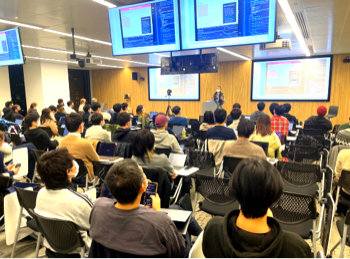
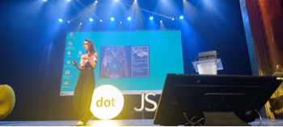
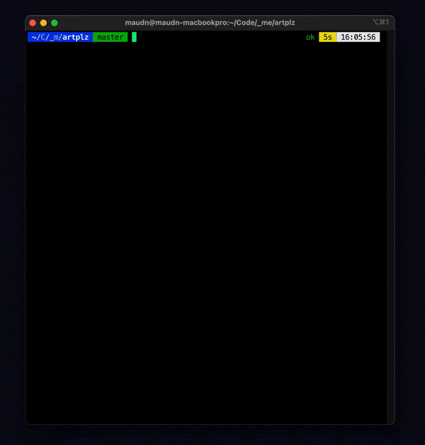

# Hi, I'm Maud.

I'm a **Developer Relations Engineer** at Google working on Chrome.

I focus on building **trustworthy web and AI systems**, bridging **web security, privacy, AI evals, and developer experience**.

   
  How it all started! Qt/OpenGL with C++.

I started coding with C++ in 2013 and was quickly drawn to the **web**.
Since 2015, I've built web products with **JavaScript**, **TypeScript**, React, and React Native. I also had a fun stint as a **UX/UI designer**.

Today, I love being a **bridge between developers and product/eng teams**: building developer tools and eval workflows, writing demos and docs, running developer research, tracking down DevX bugs, and speaking at conferences.

In the physical world, I live in Paris. You can find me roaming around taking street photos and tinkering with creative coding. Online, find me on [Bluesky](https://bsky.app/profile/maudnals.bsky.social) and [LinkedIn](https://www.linkedin.com/in/maudnalpas/) (previously on [X](https://x.com/maudnals?lang=en)).

## ✨ Selected work

- **WebMCP Security (reference demo + video):** Led Chrome's WebMCP security guidance for web developers, turning indirect prompt injection and security UX risks into practical patterns developers can ship. I built Chrome's reference security demo including interactive attack scenarios, which Chrome's WebMCP security engineers use directly to test and demonstrate protections working. I authored Chrome's flagship video on building safer WebMCP tools. [Live demo](https://googlechromelabs.github.io/webmcp-tools/demos/smart-home/) • [Security scenarios](https://github.com/GoogleChromeLabs/webmcp-tools/tree/main/demos/smart-home#-security-scenarios) • [Video](https://www.youtube.com/watch?v=YCOy5uGJnQA)
- **WebMCP Evals (2M+ views):** I authored and filmed Chrome's flagship video on evaluating WebMCP tools (2M+ views!) and contributed to the open-source WebMCP evals CLI for testing tool calling. [Video](https://www.youtube.com/watch?v=2jb6D2yhdis) • [CLI code](https://github.com/GoogleChromeLabs/webmcp-tools/tree/main/webmcp-evals) • [My PRs](https://github.com/GoogleChromeLabs/webmcp-tools/pulls?q=is%3Apr+is%3Aclosed+author%3Amaudnals)
- **AI Evals for Web Developers (40k+ views):** Launched a hands-on course, companion repo, and YouTube Shorts series on testing AI features instead of relying on vibes. [Course](https://developer.chrome.com/docs/ai/evals) • [Code](https://github.com/GoogleChromeLabs/web-ai-demos/tree/main/evals-course) • [Shorts](https://www.youtube.com/shorts/WufG1eBT0dU)
- **Web Security & Passwordless Auth:** Built `strict-csp-html-webpack-plugin` for hash-based XSS protection and authored Google's server-side Passkeys implementation guide. [strict-csp](https://github.com/google/strict-csp/tree/main/strict-csp-html-webpack-plugin) • [Passkeys guide](https://developers.google.com/identity/passkeys/developer-guides/server-introduction)

## ⭐ Open-source demos and tools

### AI & Agent Security

- WebMCP Smart Home security reference demo (indirect prompt injection + security hint toggles, used directly by Chrome's WebMCP security engineers to test and demonstrate protections): [Live demo](https://googlechromelabs.github.io/webmcp-tools/demos/smart-home/) • [Security scenarios](https://github.com/GoogleChromeLabs/webmcp-tools/tree/main/demos/smart-home#-security-scenarios)
- WebMCP evals CLI (key contributions to tool-calling evaluation DevX): [Code](https://github.com/GoogleChromeLabs/webmcp-tools/tree/main/webmcp-evals) • [My PRs](https://github.com/GoogleChromeLabs/webmcp-tools/pulls?q=is%3Apr+is%3Aclosed+author%3Amaudnals)
- Toxicity warning with client-side AI: [Code](https://github.com/GoogleChromeLabs/web-ai-demos/tree/main/toxic-review-warning) • [Live demo](https://chrome.dev/web-ai-demos/toxic-review-warning/)
- Product review autorating with client-side AI: [Code](https://github.com/GoogleChromeLabs/web-ai-demos/tree/main/product-review-auto-rating-io) • [Live demo](https://chrome.dev/web-ai-demos/product-reviews/)
- Product review suggestions: [Code](https://github.com/GoogleChromeLabs/web-ai-demos/tree/main/product-review-suggestions) • [Live demo](https://chrome.dev/web-ai-demos/product-review-suggestions/)
- Performance tips for client-side AI: [Code](https://github.com/GoogleChromeLabs/web-ai-demos/tree/main/perf-worker-gemma) • [Live demo](https://chrome.dev/web-ai-demos/perf-client-side-gemma-worker/)

### Security, Privacy, Authentication

- Autofill observer: [Code](https://github.com/GoogleChromeLabs/web-identity-demos/tree/main/autofill-observer-demo) • [Live demo](https://chrome.dev/web-identity-demos/autofill-observer-demo/address.html)
- [Reporting API](https://developer.chrome.com/docs/capabilities/web-apis/reporting-api#demo_and_code)
- [ROR (Passkey reuse across sites)](https://web.dev/articles/webauthn-related-origin-requests#demo)

### Developer tooling

- strict-csp-html-webpack-plugin: A webpack plugin that configures a strict, hash-based CSP for a single-page application. It uses the strict-csp library to form a CSP and hooks into the popular HtmlWebpackPlugin to set up this CSP as a meta HTML tag. [Source code](https://github.com/google/strict-csp/tree/main/strict-csp-html-webpack-plugin) • [npm entry](https://www.npmjs.com/package/strict-csp-html-webpack-plugin)
- noise-lab: A tool to onboard and experiment with summary reports and noise in [Privacy Sandbox Measurement APIs](https://developers.google.com/privacy-sandbox/private-advertising). [Source code](https://github.com/privacysandbox/noise-lab) • [Docs](https://developer.chrome.com/docs/privacy-sandbox/summary-reports/design-decisions/)
- I [advocate / file bugs for DevX improvement in Chrome DevTools and Chrome browser](https://issues.chromium.org/issues?q=reporter:maudn@chromium.org).

## 👩🏻‍💻 Developer research and communication

- I build internal tooling to turn scattered developer feedback and field notes into structured, searchable insights for Chrome product teams.
- I bridge external devs with internal teams to land DevX improvements, like for example [here](https://github.com/privacysandbox/privacy-sandbox-dev-support/issues/41).
- I research [what web developers think about AI](https://web.dev/blog/ai-chats-and-takeaways).
- I [drive technical outreach](https://groups.google.com/u/0/a/chromium.org/g/attribution-reporting-api-dev/search?q=maud%20nalpas) with all early testers of a privacy-preserving web API for ad conversion measurement.

## ✏️ Articles, guides, and videos (selection)

### AI & WebMCP

- [[Video] How to evaluate your WebMCP tools](https://www.youtube.com/watch?v=2jb6D2yhdis) (2M+ views)
- [[Video] How to build safer WebMCP tools for AI agents](https://www.youtube.com/watch?v=YCOy5uGJnQA)
- [Full course on AI evals](https://developer.chrome.com/docs/ai/evals) with [code repository](https://github.com/GoogleChromeLabs/web-ai-demos/tree/main/evals-course) and YouTube Shorts (40k+ views: [Intro](https://www.youtube.com/shorts/WufG1eBT0dU), [Design](https://www.youtube.com/shorts/m91Gj3efqjE), [Mental model](https://www.youtube.com/shorts/ji08ILsXQ7M))
- [Built-in AI best practices](https://developer.chrome.com/docs/ai/built-in-ai-dos-donts)
- 2-part developer guide on client-side toxicity detection: [Part 1](https://web.dev/articles/ai-detect-toxicity-context), [Part 2](https://web.dev/articles/ai-detect-toxicity-build), [Social media post](https://www.linkedin.com/posts/maudnalpas_ai-webai-toxicity-activity-7262487002875416576-jsMP/)
- [Understand LLM sizes](https://web.dev/articles/llm-sizes)
- [Practical prompt engineering for smaller LLMs](https://web.dev/articles/practical-prompt-engineering)
- [Improve performance and UX for client-side AI](https://web.dev/articles/client-side-ai-performance)

### Security, Privacy, Authentication

- [Measure browser autofill on your forms](https://web.dev/articles/autofill-measure)
- [Seamless credential sharing](https://www.linkedin.com/posts/maudnalpas_help-your-users-sign-in-smoothly-with-seamless-activity-7257724717015478272-ypoC)
- Full guide on server-side passkey implementation: [Part 1](https://developers.google.com/identity/passkeys/developer-guides/server-introduction), [Part 2](https://developers.google.com/identity/passkeys/developer-guides/server-registration), [Part 3](https://developers.google.com/identity/passkeys/developer-guides/server-authentication), [Social media post](https://www.linkedin.com/posts/chrome-for-developers_passkeysweek-activity-7264427159430000640-zBHX)
- [Passkey reuse across sites](https://web.dev/articles/webauthn-related-origin-requests)
- HTTPS for local development: [When](https://web.dev/articles/when-to-use-local-https) and [How](https://web.dev/articles/how-to-use-local-https)
- [Referrer and Referrer-Policy best practices](https://web.dev/articles/referrer-best-practices)
- [Reporting API](https://developer.chrome.com/docs/capabilities/web-apis/reporting-api)
- [Chrome's move to one-time permissions](https://developer.chrome.com/blog/one-time-permissions)
- [Security headers quick reference](https://web.dev/articles/security-headers)
- [Debugging guide for Attribution Reporting](https://developer.chrome.com/docs/privacy-sandbox/attribution-reporting-debugging/)
- [Attribution Reporting docs](https://privacysandbox.google.com/private-advertising/attribution-reporting)
- [Secure your site with two-factor authentication with a security key (WebAuthn)](https://developers.google.com/codelabs/webauthn-2fa-key#0)
- [[Video series] Tutorial: Noise Lab](https://www.youtube.com/results?search_query=noise+lab+maud+nalpas)

## 🎙️ Talks

| Talk                                                                                                                                                            |                                   Where & When |
| :-------------------------------------------------------------------------------------------------------------------------------------------------------------- | ---------------------------------------------: |
| [No buzz, just build: client-side AI](https://io.google/2024/explore/47fc6e98-8359-4be0-b9b9-4bc7b28bd063/)                                                     |                    🕸️ Google I/O online · 2024 |
| [Passkeys, for a passwordless future](https://www.linkedin.com/feed/update/urn:li:activity:7214590199463342080/)                                                |                          🇫🇷 DotJS Paris · 2024 |
| [Passkeys 101](https://www.linkedin.com/feed/update/urn:li:activity:7133809102564020225/)                                                                       |                             🇩🇪 MunichJS · 2023 |
| [Passkeys workshop](https://authenticatecon.com/session/easy-passkeys-on-the-web-with-browser-autofill-with-the-chrome-team/)                                   |               🇺🇸 Authenticate San Diego · 2023 |
| [XSS protections with strict CSP](https://docs.google.com/presentation/d/1MwxyhDJPDIx5orn6YIL6JJXOkZ_5aUyZ5181IIvZC4w/pub?start=false&loop=false&delayms=60000) |             🇯🇵 Chrome Tech Nights Tokyo · 2023 |
| [Passkeys, autofill, 3P cookies: the Web in 2023](https://www.linkedin.com/feed/update/urn:li:activity:6930220375825915905/)                                    |                    🇩🇪 Berlin GDE Summit · 2023 |
| [The hitchhiker's guide to web privacy](https://www.youtube.com/watch?v=9UgS81AaMU4)                                                                            | 🇳🇱🇫🇷 Fronteers Utrecht + DevFest Nantes · 2022 |
| [HAUNTED: Chrome's vision for post-Spectre web development](https://snyk.io/videos/haunted-chromes-vision-post-spectre-web-development/)                        |                       🕸️ SnykCon online · 2021 |
| [Prepare for a more private web](https://www.youtube.com/watch?v=1g2uQfP1Q3U)                                                                                   |                    🕸️ Google I/O online · 2021 |
| [Introducing the privacy budget](https://www.youtube.com/watch?v=0STgfjSA6T8)                                                                                   |      🕸️ Chrome Developers Summit online · 2020 |

   
  One of my favorite talks ❤️ Web security, Tokyo. I love small, engaged audiences I can directly interact with.

   
  DotJS stage, 1000+ live attendees. 2024, Paris.

## 💙 Community & leadership

- **Women Engineers community at Google Paris (2026):** I led and grew our local community of 80+ engineers across Chrome, YouTube, Google DeepMind, and other teams. Bringing people together through monthly fireside chats, lunches, coffee chats, and office-wide events has been a highlight of my year, creating space to support one another and connecting me with top local engineers across Google.
- **External Paris tech meetups:** I also build local developer community outside Google by organizing and hosting sold-out tech meetups in Paris (~70 attendees) for underrepresented groups and AI builders:
  - [Women Techmakers Paris (Autumn 2026)](https://www.linkedin.com/feed/update/urn:li:activity:7511745656697372672/) and [earlier meetup](https://www.linkedin.com/posts/maudnalpas_ai-activity-7272590428141502465-jusB)
  - [Duchess France x Dev With AI (Nov 2026)](https://luma.com/2krybbmv) ([Dev With AI listing](https://luma.com/dm22))
  - [Ladies of Code Paris](https://www.linkedin.com/posts/maudnalpas_googleaihub-activity-7247235655427076097--lX7/)

## 🤝 Misc OSS contributions

- I [added one-time permission implementation](https://github.com/chromium/permission.site/commits?author=maudnals) to the Chrome permissions public demo
- I [contributed dev guidance](https://github.com/passkeydeveloper/passkeys.dev/commits?author=maudnals) to passkeys.dev
- I [improved onboarding docs](https://github.com/breadboard-ai/breadboard/commits?author=maudnals) for a Gen AI prototyping tool
- I reviewed the [Privacy chapter of the Web Almanac 2021](https://almanac.httparchive.org/en/2021/privacy)
- I coordinated a [full course on web privacy](https://web.dev/learn/privacy)
- I filed a [common issue](https://github.com/huggingface/transformers.js/issues/366) on Transformers.js

## 🎨 Creative coding & fun

- [artplz](https://github.com/maudnals/artplz): Art in your terminal! It's dynamic, and should work with any painter you enter as a CLI argument. Under the hood, there's a Wikipedia scraper.
- [cssunrise](https://github.com/maudnals/csssunrise): A 1-minute sunrise in CSS.
- [Hello worlds](https://maudnals.github.io/hello-worlds): Planets and exoplanets in 3D.

   
  My artplz project 

